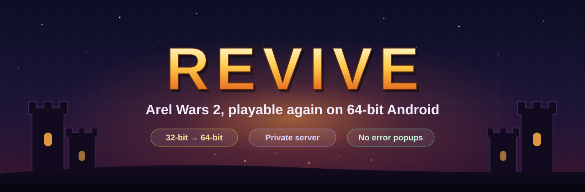
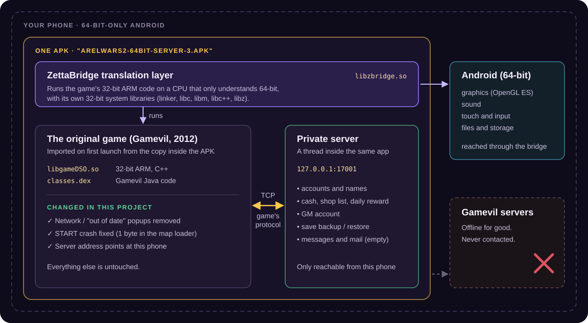

<p align="center">
  
</p>

<p align="center">
  <a href="https://github.com/Builder0Student/revive/releases/latest"></a>
  
  
  
</p>

<p align="center">
  <a href="#-download">Download</a> ·
  <a href="#-install">Install</a> ·
  <a href="#-how-it-was-done">How it was done</a> ·
  <a href="#-gm-game-master">GM</a> ·
  <a href="#-whats-not-there">Limits</a> ·
  <a href="docs/HOW-IT-WORKS.md">Technical deep dive</a>
</p>

---

**Arel Wars 2** (Gamevil, 2012) stopped working for two reasons. New phones like the Galaxy S24 FE can only run 64-bit apps, and the game is 32-bit. Gamevil also shut down the game's servers, so it now hangs on network checks and pops up errors.

**Revive** solves both without remaking anything. It's the original game, with three small patches, running inside a 32-to-64-bit translation layer, plus a private server that lives inside the same app. You don't need an internet connection, an account or an emulator.

<p align="center">
  
</p>

## 📦 Download

Grab the files from the **[latest release](https://github.com/Builder0Student/revive/releases/latest)**.

| File | What it is | Size |
|---|---|---|
| **`ArelWars2-64bit-server-3.apk`** | **The one to install.** The game, translation layer, private server and all fixes in one app. | 45.2 MB |
| `ZettaBridge-AW2.apk` | The translation layer on its own, with an **Import APK** button for running your own 32-bit APKs. It has no game, no server and none of the fixes. | 3.0 MB |

<details>
<summary>SHA-256 checksums</summary>

```
2793ac5edc117a6555674a94812ad25dc4a19c658fcc70a3382d6a11f261e60a  ArelWars2-64bit-server-3.apk
85e21da60b2466d296acead69db84d6e440dbf0f0c15336416b171640eac5fbb  ZettaBridge-AW2.apk
```

Signing certificate of the game APK (SHA-256), which is the same for every Revive build:
`ee7a8f77eccf873ff995c7d811595825ebea8f078863f54a7c2b0cbfe3b7fe21`
</details>

## 📲 Install

1. Download **`ArelWars2-64bit-server-3.apk`** on your phone.
2. Open it, and allow "install unknown apps" for your browser or file manager if Android asks.
3. **Updating from an earlier Revive build?** Just install over it. Every build is signed with the same key, so your save is kept.
   **Have a different ZettaBridge or Arel Wars 2 build installed?** Uninstall it first. They share the package name `com.zettabridge.launcher` but use a different signature, so Android won't install one over the other.
4. Open **Arel Wars 2**. The first launch unpacks the game, which takes a few seconds.
5. Press **START**.

> [!NOTE]
> The two APKs in the release are alternatives. Install one or the other, not both.

## 🛠 How it was done

### 1. The game is 32-bit, the phone is 64-bit only → a translation layer

All of the game's logic lives in `libgameDSO.so`, a 32-bit ARM C++ library, alongside cocos2d, sound and Immersion vibration libraries. A 64-bit-only phone has no way to load it.

**ZettaBridge** is a small arm64 Android app built for this project. Its core, `libzbridge.so`, runs the game's 32-bit ARM code on the 64-bit CPU. It carries its own 32-bit system libraries (`linker`, `libc`, `libm`, `libc++`, `libz`, `liblog`) and small stand-ins for `libEGL`, `libGLESv1_CM`, `libGLESv2`, `libandroid` and `libjnigraphics`. Those stand-ins pass each call through to the phone's real 64-bit libraries, which is how the game gets graphics, sound, touch and files. The game's Java side runs as a normal app inside the launcher's `:guest` process, using a virtualised package manager.

The original game APK is stored inside the launcher at `assets/bundled/game.apk`, uncompressed. On first launch it's imported automatically, and it's imported again whenever the app is updated.

### 2. The servers are gone → a private server inside the app

The game's network code (`CPdNet` in `libgameDSO.so`) speaks a small binary protocol over TCP. Each packet is `u16 size | u16 command | body`, little-endian. The answer to command *N* is *N + 1*, and its first byte is the result code. The protocol was worked out by reading the game's own code, which still has its C++ symbol names. That covered account login, registration, cash, the shop list, daily reward, messages, mail and save backup, and [the full table is in the deep dive](docs/HOW-IT-WORKS.md#the-protocol).

The server is plain Java with no dependencies. A one-line `Application` subclass starts it as a background thread when the app starts. It listens on `127.0.0.1:17001` only, so nothing outside the phone can reach it. The game's server address points there.

Gamevil's web services, such as Live login, gifts and the offerwall, now point at a closed local port. They fail instantly instead of hanging.

The server keeps its data in `Android/data/com.zettabridge.launcher/files/aw2server/`: settings, accounts, saved backups and a log.

### 3. "Network Error" and "out of date" popups → removed at the source

The game's code was decompiled with apktool, and both popups were traced to where they start:

| Popup | Where it came from | Fix |
|---|---|---|
| **Network Error / Network Not Available** | Gamevil's analytics library (`GvTorchwood`). `GvActivity.onResume()` starts it through `doJellyBeen()` and `doTorchwood()`, it tries to reach Gamevil, and it complains when it can't. | Both methods now return immediately. |
| **"Can't connect to Market… out of date"** and **"billing not supported"** | The old Android Market in-app billing check in `ArelWars2Launcher` and its purchase observer. | Those three `showDialog()` calls were removed. The "purchase complete" dialog was kept. |

Only `classes.dex` was rebuilt. It was copied back into the **original** game APK, and every other file kept its exact bytes and compression. The native libraries and assets weren't touched by this step.

### 4. Crash after pressing START → one byte in the map loader

After the popups were gone, pressing START crashed with `SIGSEGV` in `CPdMap::SetupScrollData`, called from `CPdMap::Load`. The bug sits one step earlier, in `CMapLayerData::PreLoad`:

```asm
; libgameDSO.so (Thumb), file offset 0xa9a44
00 2b      cmp  r3, #0          ; is the layer data pointer set?
1d dd      ble  0xa9a84         ; signed: "<= 0" counts as "no data"   ← before
1d d0      beq  0xa9a84         ; only a real NULL counts as "no data" ← after
```

`ble` is a signed comparison. On 2012 phones the game's memory sat low in the address space, so real pointers always looked positive. Under the translation layer the game's memory lives above `0x80000000`. A signed compare reads those addresses as negative, so the map layers were skipped and the scroll setup read data that was never loaded.

The fix changes one byte at `0xa9a47`, from `0xDD` (`ble`) to `0xD0` (`beq`). It was applied to both copies of the library (`armeabi` and `armeabi-v7a`), and it's the only byte that differs from the original.

### 5. Packaging and signing

The final APK is the ZettaBridge launcher with the patched game inside and the server added as a second dex file (`classes2.dex`). It's signed with a private key that is **not** in this repository. Every build uses that same key, which is why updates install over the previous version and keep your progress.

## 👑 GM (game master)

The **first account created on your phone becomes the GM**. The GM's cash balance is fixed at **9,999,999**, and spending it never lowers it. Any other account starts with 0 cash.

These values live in `aw2server.properties`, in the server's data folder:

| Setting | Default | Meaning |
|---|---|---|
| `gm_name` | the first account's name | The account with this name is the GM. |
| `gm_cash` | `9999999` | GM cash balance (max 99,999,999, which is the game's own cap). |
| `player_cash` | `0` | Starting cash for any other account. |

Gold is stored by the game on the phone, not on the server, so the server doesn't change it.

## 🚧 What's not there

- **PvP, friends and sending mail.** Those messages aren't decoded yet. The server answers them with a short "not available on the private server" note instead of an error loop.
- **Real-money purchases.** Google's old billing service no longer exists. The GM's cash covers that.
- **Online anything.** Everything stays on your phone.

## 📜 Changelog

See **[CHANGELOG.md](CHANGELOG.md)**.

## ⚖️ Credits & disclaimer

*Arel Wars 2* and all of its art, music and code are © Gamevil Inc. This is a fan preservation project and isn't affiliated with or endorsed by Gamevil. The game itself is unchanged apart from the patches described above. Please only use it with a copy of the game you own.

This repository holds the write-up and the release builds. It doesn't contain the game's source code.
